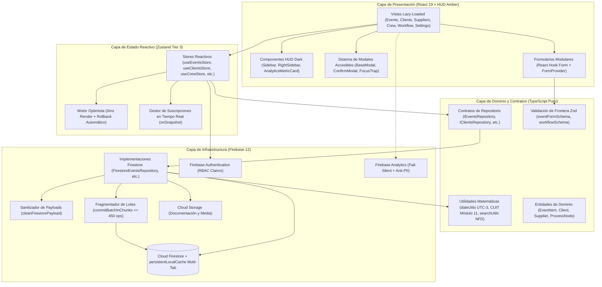
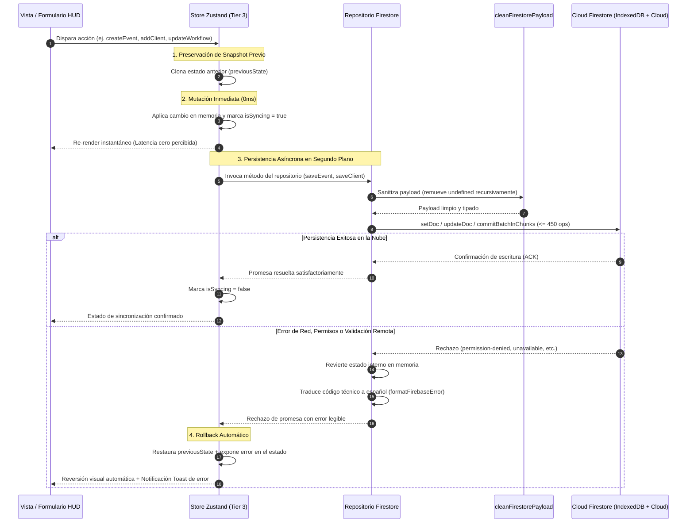

# Arquitectura del Sistema — METODICAH

## 1. Filosofía de Diseño y Capas Arquitectónicas

**METODICAH** adopta una arquitectura modular orientada al dominio inspirada en los principios de **Clean / Hexagonal Architecture**, complementada por **Zustand Tier 3 (Optimistic UI en $0\text{ ms}$ + Sincronización Reactiva)** y **Google Cloud Firestore** con persistencia local nativa offline.

### Invariantes Estructurales de Diseño
1. **Aislamiento e Inmunidad de la Capa de Dominio:**
   - La lógica matemática de negocio (cálculo de carga horaria de grafos, validaciones CUIT/CUIL, ordenamiento temporal UTC-3) es **100% síncrona, pura y determinista**.
   - No contiene dependencias de `react`, `zustand`, `firebase/*` ni objetos globales de navegador (`window`, `localStorage`).
2. **Persistencia Directa sin Repositorio Dual ([ADR-001](file:///C:/Users/juanm/Desktop/Workspace/METODICAH/docs/adr/ADR-001-eliminacion-repositorio-dual-y-optimistic-ui-firestore.md)):**
   - Se eliminaron las implementaciones locales redundantes (`LocalStorage*Repository`). Todas las entidades de negocio se persisten y sincronizan exclusivamente mediante repositorios de Firestore (`Firestore*Repository`).
   - `localStorage` se restringe de forma estricta al almacenamiento de preferencias cosméticas de interfaz de usuario (`STORAGE_KEYS`).
3. **Inicialización Limpia sin Fallbacks Mock ([ADR-002](file:///C:/Users/juanm/Desktop/Workspace/METODICAH/docs/adr/ADR-002-inicializacion-limpia-y-desacople-de-fallbacks-mock.md)):**
   - Los repositorios y los stores arrancan en colecciones vacías (`[]` y `{}`). Si Cloud Firestore no tiene documentos creados, el sistema refleja de forma transparente el estado vacío real sin inyectar datos ficticios en la base de datos de producción.

---

## 2. Ciclo de Vida de Mutación Optimista y Sincronización en Tiempo Real

Toda operación de creación, actualización o eliminación disparada por el usuario opera en cuatro fases deterministas:

### Gestión de Listeners en Tiempo Real (`onSnapshot`)
1. **Encapsulamiento Fuera de Vistas:**
   Queda terminantemente prohibido instanciar `onSnapshot` directamente dentro del cuerpo de componentes visuales.
2. **Suscripción Gobernada por el Layout Central:**
   En [`AppLayout.tsx`](file:///C:/Users/juanm/Desktop/Workspace/METODICAH/src/layouts/AppLayout.tsx), las suscripciones (`subscribeEvents`, `subscribeClients`, etc.) se inicializan en un único `useEffect` raíz y devuelven su correspondiente función limpiadora `unsubscribe()`, evitando fugas de memoria o suscripciones fantasma al navegar.

---

## 3. Telemetría Privada, Ética y Fail-Silent (Regla Anti-PII)

En [`src/services/firebase.ts`](file:///C:/Users/juanm/Desktop/Workspace/METODICAH/src/services/firebase.ts):
- **Verificación de Soporte:** Se consulta asíncronamente `await isSupported()` antes de inicializar Firebase Analytics. Si el navegador del usuario bloquea cookies de terceros o utiliza extensiones de bloqueo de rastreo (ad-blockers), la inicialización falla silenciosamente (*fail-silent*) sin interrumpir la experiencia de usuario.
- **Regla Estricta Anti-PII (Personally Identifiable Information):**
  La función utilitaria `trackEvent(eventName, params)` prohíbe el envío de nombres de personas, direcciones de correo electrónico, números de teléfono, CUIT/CUIL, importes económicos o domicilios. Únicamente se reportan contadores, categorías genéricas o identificadores opacos de sistema.

---

## 4. Estrategia de Bundling y Code-Splitting en Vite

Para asegurar una carga inicial de la aplicación inferior a $1.5\text{ segundos}$ en redes móviles de producción en campo:
- **Carga Diferida de Rutas (`React.lazy`):** Cada página principal (`EventsView`, `ClientsView`, `SuppliersView`, `CrewView`, `WorkflowView`, `SettingsView`, `EventDetailView`) se empaqueta en su propio chunk asíncrono.
- **Particionado Manual de Librerías Pesadas (`manualChunks`):**
  En [`vite.config.ts`](file:///C:/Users/juanm/Desktop/Workspace/METODICAH/vite.config.ts):
  - `firebase-vendor`: `@firebase/app`, `@firebase/auth`, `@firebase/firestore`, `@firebase/storage`, `@firebase/analytics`.
  - `flow-vendor`: `@xyflow/react` (descargado única y exclusivamente al ingresar a `/workflow`).
  - `pdf-vendor`: `jspdf`, `html2canvas` (descargado bajo demanda cuando el usuario pulsa "Exportar PDF").
  - `ui`: `lucide-react`, `zustand`, `react-hook-form`, `zod`.

---

## 5. Pirámide de Testing y Quality Gates

La confiabilidad del software se valida mediante una batería automatizada con **20 archivos de suite y 171 tests unitarios e integrados** ejecutados sobre **Vitest 5 + jsdom**:
1. **Pruebas de Dominio y Utilidades Matemáticas:**
   - Algoritmo de validación CUIT/CUIL vía Módulo 11 ([`clientUtils.test.ts`](file:///C:/Users/juanm/Desktop/Workspace/METODICAH/src/utils/clientUtils.ts)).
   - Invariante de fechas al mediodía local UTC-3 ([`dateUtils.test.ts`](file:///C:/Users/juanm/Desktop/Workspace/METODICAH/src/utils/dateUtils.test.ts)).
   - Métricas y dependencias acíclicas en flujos DAG ([`workflowUtils.test.ts`](file:///C:/Users/juanm/Desktop/Workspace/METODICAH/src/utils/workflowUtils.test.ts)).
2. **Pruebas de Repositorios y Sanitización:**
   - Sanitización estricta de campos `undefined` antes de persistir en Cloud Firestore ([`repositories.test.ts`](file:///C:/Users/juanm/Desktop/Workspace/METODICAH/src/services/repositories/repositories.test.ts)).
   - Fragmentación en lotes $\le 450$ operaciones y borrado atómico en cascada ([`firestoreBatchUtils.test.ts`](file:///C:/Users/juanm/Desktop/Workspace/METODICAH/src/services/repositories/firebase/firestoreBatchUtils.test.ts)).
3. **Pruebas de Stores Zustand (Tier 3 Optimistic & Rollback):**
   - Comprobación de aplicación inmediata en $0\text{ ms}$ y reversión exacta a estado anterior ante excepciones simuladas de backend ([`stores.test.ts`](file:///C:/Users/juanm/Desktop/Workspace/METODICAH/src/stores/stores.test.ts)).
4. **Pruebas de Integración y Ruteo:**
   - Conmutación libre de oscilaciones entre flujos de trabajo ([`workflow.test.tsx`](file:///C:/Users/juanm/Desktop/Workspace/METODICAH/src/components/workflow/workflow.test.tsx)).
   - Protección de rutas privadas y vistas de contingencia 404 ([`routes.test.tsx`](file:///C:/Users/juanm/Desktop/Workspace/METODICAH/src/routes.test.tsx)).
