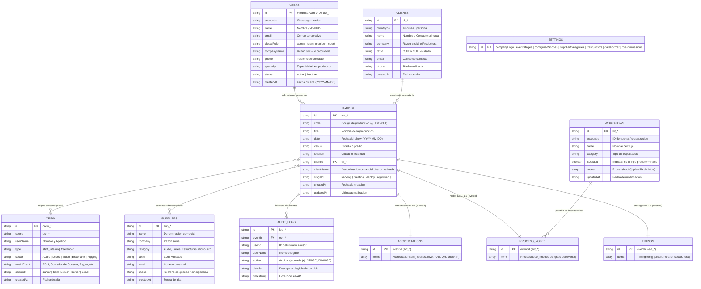

# Esquema de Base de Datos y Seguridad — METODICAH

## 1. Diagrama Entidad-Relación en Cloud Firestore

Cloud Firestore implementa una estructura NoSQL documental orientada a accesos en tiempo constante $O(1)$ sin escaneos cruzados costosos:



---

## 2. Diccionario de Colecciones

### 2.1 Colección `/users/{userId}`
Contiene los perfiles de usuario y credenciales vinculadas a Firebase Authentication.

| Campo | Tipo | Requerido | Descripción / Invariante |
| :--- | :--- | :---: | :--- |
| `id` | `string` | Sí | UID de Firebase Auth (longitud $\le 128$, inmutable en actualización). |
| `name` | `string` | Sí | Nombre y apellido del usuario ($1 \le \text{size} \le 150$). |
| `email` | `string` | Sí | Correo electrónico corporativo ($3 \le \text{size} \le 254$). |
| `globalRole`| `string` | Sí | Nivel de autorización: `'admin'`, `'team_member'`, `'guest'`. |
| `accountId` | `string` | No | ID de la cuenta u organización ($acc\_*$). |
| `companyName`| `string`| No | Productora o razón social a la que pertenece. |
| `status` | `string` | No | Estado de cuenta: `'active'` o `'inactive'`. |
| `createdAt` | `string` | No | Fecha de creación en formato local `YYYY-MM-DD`. |

### 2.2 Colección `/events/{eventId}`
Registros principales de las producciones planificadas o ejecutadas.

| Campo | Tipo | Requerido | Descripción / Invariante |
| :--- | :--- | :---: | :--- |
| `id` | `string` | Sí | Identificador con prefijo `evt_*`. |
| `code` | `string` | Sí | Código alfanumérico para documentación interna (`EVT-001`). |
| `title` | `string` | Sí | Título descriptivo de la producción. |
| `date` | `string` | Sí | Fecha principal en formato `YYYY-MM-DD` (UTC-3). |
| `venue` | `string` | Sí | Espacio o recinto donde se desarrollará el evento. |
| `location`| `string` | Sí | Localidad o ciudad de emplazamiento. |
| `clientId` | `string` | Sí | Referencia foránea al cliente (`cli_*`). |
| `clientName`| `string` | Sí | Denominación del cliente desnormalizada para lectura rápida $O(1)$. |
| `stageId` | `string` | Sí | Clave de etapa válida dentro de la configuración de etapas. |
| `timeRange`| `object` | Sí | Objeto con `{ startTime: string, endTime: string }`. |
| `createdAt`| `string` | Sí | Marca temporal de alta. |
| `updatedAt`| `string` | Sí | Marca temporal de última modificación. |

### 2.3 Colección `/timings/{eventId}`
Almacena el cronograma de actividades de un evento específico en un único documento $1:1$ para lectura atómica.

| Campo | Tipo | Requerido | Descripción / Invariante |
| :--- | :--- | :---: | :--- |
| `id` | `string` | Sí | Debe coincidir exactamente con el `eventId` padre. |
| `items` | `list` | Sí | Lista de `TimingItem` ($\le 500$ ítems por documento). |

### 2.4 Colección `/accreditations/{eventId}`
Almacena la nómina de acreditaciones y credenciales del personal técnico, proveedores e invitados asignados a la producción en un documento atómico $1:1$.

| Campo | Tipo | Requerido | Descripción / Invariante |
| :--- | :--- | :---: | :--- |
| `id` | `string` | Sí | Coincide exactamente con el `eventId` padre. |
| `items` | `list` | Sí | Lista de `AccreditationItem` ($\le 500$ acreditados por documento). |

#### Estructura interna de `AccreditationItem`:
- `id` (`string`): Identificador único con prefijo `acc_*`.
- `eventId` (`string`): Clave foránea al evento asociado.
- `firstName` (`string`) & `lastName` (`string`): Nombre y apellido del acreditado ($2 \le \text{size} \le 80$).
- `documentNumber` (`string`): DNI, Pasaporte o identificación oficial ($6 \le \text{size} \le 20$).
- `role` (`string`): Función técnica en el espectáculo (ej. *Operador de Luces*, *Rigger*, *Runner*).
- `company` (`string`): Proveedor, empresa técnica o productora a la que pertenece.
- `accessLevel` (`string`): Categoría exclusiva de acceso: `'ALL ACCESS'`, `'STAFF'` o `'GUEST'`.
- `status` (`string`): Estado operativo: `'solicitada'`, `'aprobada'`, `'impresa'`, `'en_sitio'` o `'revocada'`.
- `qrCode` (`string`): Código alfanumérico determinista seguro para escaneo en puerta (`MET-XXXX-XXXX`).
- `checkInAt` (`string | null`): Marca temporal ISO del ingreso físico al predio.
- `checkOutAt` (`string | null`): Marca temporal ISO de salida del predio.
- `checkInBy` (`string | null`): Nombre o ID del operador de portería que validó el acceso.
- `insuranceVerified` (`boolean`): Bandera de confirmación de seguro de accidentes laborales (ART).
- `emergencyPhone` (`string | undefined`): Teléfono de urgencias médicas o contacto directo.
- `notes` (`string | undefined`): Indicaciones especiales de seguridad o retiro de equipamiento.

### 2.5 Colección `/process_nodes/{eventId}`
Almacena los nodos de proceso DAG vinculados a un evento en un único documento $1:1$.

| Campo | Tipo | Requerido | Descripción / Invariante |
| :--- | :--- | :---: | :--- |
| `id` | `string` | Sí | Coincide exactamente con el `eventId`. |
| `items` | `list` | Sí | Lista de `ProcessNode` ($\le 500$ nodos por documento). |

### 2.6 Colección `/audit_logs/{logId}`
Registro inmutable de auditoría para trazabilidad de cambios de estado y modificaciones críticas.

| Campo | Tipo | Requerido | Descripción / Invariante |
| :--- | :--- | :---: | :--- |
| `id` | `string` | Sí | Identificador único (`log_*`). |
| `eventId` | `string` | No | ID del evento asociado si corresponde. |
| `userId` | `string` | Sí | Identificador del usuario que realizó la acción. |
| `userName` | `string` | Sí | Nombre del usuario visible en la bitácora. |
| `action` | `string` | Sí | Clave de acción (`STAGE_UPDATE`, `TIMING_STATUS_UPDATE`, etc.). |
| `details` | `string` | Sí | Detalle descriptivo de la operación. |
| `timestamp`| `string` | Sí | Marca horaria formateada en hora local. |

### 2.7 Colección `/clients/{clientId}`, `/suppliers/{supplierId}` y `/crew/{memberId}`
Directorios operativos de la productora.

| Colección | Prefijo ID | Campos Obligatorios | Campos Clave Opcionales |
| :--- | :---: | :--- | :--- |
| **`/clients`** | `cli_*` | `id`, `name`, `email`, `phone`, `createdAt` | `company`, `clientType`, `taxId` (CUIT validado), `taxCondition`, `address` |
| **`/suppliers`** | `sup_*` | `id`, `name`, `company`, `category`, `email`, `phone`, `createdAt` | `taxId`, `taxCondition`, `emergencyPhone`, `paymentTerms`, `equipmentHighlights` |
| **`/crew`** | `crew_*` | `id`, `userId`, `userName`, `sector`, `roleInEvent`, `userEmail` | `seniority`, `type`, `documentNumber`, `artInsurance`, `clothingSize`, `dietaryRestrictions` |

### 2.8 Colección `/workflows/{workflowId}`
Definición de plantillas reutilizables de flujos de trabajo técnicos.

| Campo | Tipo | Requerido | Descripción / Invariante |
| :--- | :--- | :---: | :--- |
| `id` | `string` | Sí | Identificador con prefijo `wf_*`. |
| `name` | `string` | Sí | Título del flujo de trabajo. |
| `nodes` | `list` | Sí | Lista de hitos técnicos con sus posiciones relativas $(x, y)$ y aristas. |
| `isDefault` | `boolean` | No | Flag para identificar el flujo predeterminado al ingresar a la vista. |
| `accountId` | `string` | No | Aislamiento por cuenta organizativa. |

---

## 3. Protocolos de Escritura Masiva y Borrado en Cascada

1. **Límite de Operaciones por Lote (`writeBatch`):**
   - Cloud Firestore rechaza cualquier lote que supere las 500 operaciones.
   - En [`firestoreBatchUtils.ts`](file:///C:/Users/juanm/Desktop/Workspace/METODICAH/src/services/repositories/firebase/firestoreBatchUtils.ts), la función `commitBatchInChunks` fragmenta automáticamente las operaciones masivas en bloques de **máximo 450 operaciones**, procesándolos secuencialmente para respetar la cuota del SDK.
2. **Borrado en Cascada Atómico:**
   - Como Firestore no borra documentos dependientes de forma automática, [`FirestoreEventsRepository.deleteEvent`](file:///C:/Users/juanm/Desktop/Workspace/METODICAH/src/services/repositories/firebase/FirestoreEventsRepository.ts) implementa borrado en cascada obligatorio:
   ```ts
   const ops: BatchOperation[] = [
     { type: 'delete', ref: doc(collection(db, 'events'), eventId) },
     { type: 'delete', ref: doc(collection(db, 'timings'), eventId) },
     { type: 'delete', ref: doc(collection(db, 'accreditations'), eventId) },
     { type: 'delete', ref: doc(collection(db, 'process_nodes'), eventId) }
   ];
   await commitBatchInChunks(db, ops);
   ```

---

## 4. Reglas de Seguridad de Cloud Firestore ([`firestore.rules`](file:///C:/Users/juanm/Desktop/Workspace/METODICAH/firestore.rules))

- **Modo RBAC Estricto:**
  - `admin`: Acceso completo de lectura y escritura sobre todas las colecciones, configuraciones y usuarios.
  - `team_member`: Acceso de lectura y escritura operativa sobre producciones, clientes, proveedores, equipo y flujos; restringido para alterar configuraciones globales o roles de otros integrantes.
  - `guest`: Acceso de solo lectura sobre eventos y cronogramas asignados.
- **Validación Estructural de Payloads:**
  Cada regla valida que las claves obligatorias existan (`hasAll`), que no se envíen campos no reconocidos (`hasOnly`), que los tipos de datos coincidan y que los textos respeten los límites máximos de longitud.
