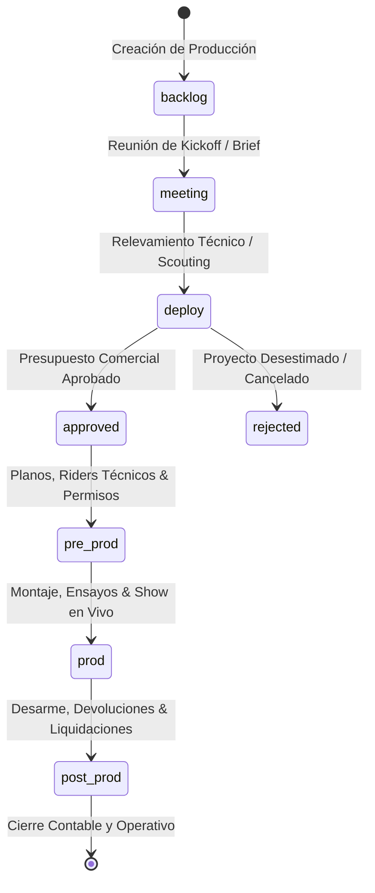
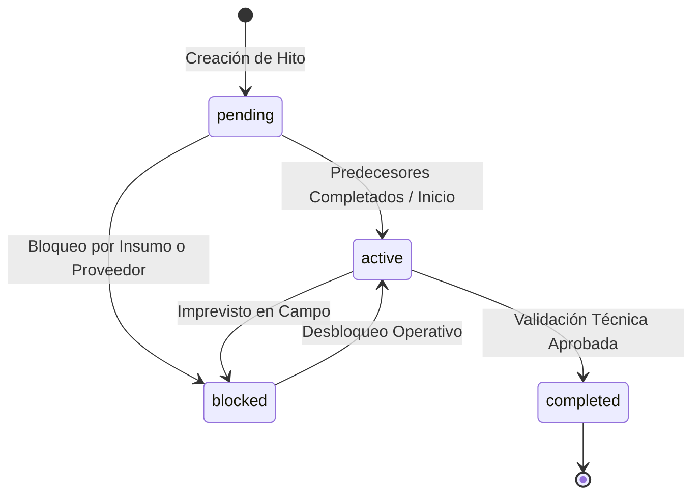
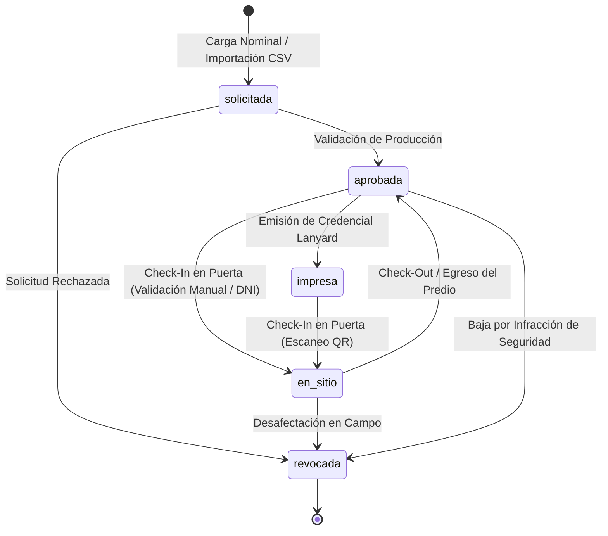

# Reglas de Negocio e Invariantes de Dominio — METODICAH

## 1. Glosario de Lenguaje Ubicuo (*Ubiquitous Language*)

Para garantizar una correspondencia unívoca entre las operaciones técnicas de producción y la base de código, todo el equipo técnico y de ingeniería utiliza la siguiente terminología estandarizada:

| Término Operativo | Definición de Negocio | Tipo / Entidad en Código |
| :--- | :--- | :--- |
| **Producción / Evento** | Proyecto global que abarca la planificación, montaje y ejecución del espectáculo. | [`EventItem`](file:///C:/Users/juanm/Desktop/Workspace/METODICAH/src/types/metodicah.ts) |
| **Etapa de Producción** | Fase operativa dentro del pipeline (ej. *Backlog*, *Scouting*, *Show en Vivo*). | [`EventStageConfig`](file:///C:/Users/juanm/Desktop/Workspace/METODICAH/src/types/metodicah.ts) |
| **Run of Show / Timing** | Cronograma minuto a minuto de las actividades técnicas durante la jornada. | [`TimingItem`](file:///C:/Users/juanm/Desktop/Workspace/METODICAH/src/types/metodicah.ts) |
| **Flujo de Trabajo (DAG)** | Grafo acíclico dirigido que modela las dependencias críticas de hitos técnicos. | [`WorkflowDefinition`](file:///C:/Users/juanm/Desktop/Workspace/METODICAH/src/types/metodicah.ts) |
| **Hito / Nodo de Proceso** | Unidad indivisible de trabajo técnico con predecesores y sucesores. | [`ProcessNode`](file:///C:/Users/juanm/Desktop/Workspace/METODICAH/src/types/metodicah.ts) |
| **Personal Técnico (Crew)** | Staff interno o técnico independiente asignado a sectores especializados. | [`EventCrewMember`](file:///C:/Users/juanm/Desktop/Workspace/METODICAH/src/types/metodicah.ts) |
| **Proveedor Homologado** | Empresa contratista externa de servicios de equipamiento (Audio, Luces, Estructuras). | [`Supplier`](file:///C:/Users/juanm/Desktop/Workspace/METODICAH/src/types/metodicah.ts) |
| **Comitente / Cliente** | Persona física o jurídica contratante del servicio de producción integral. | [`Client`](file:///C:/Users/juanm/Desktop/Workspace/METODICAH/src/types/metodicah.ts) |
| **Acreditación de Producción** | Pase nominal emitido para control de acceso de personal técnico, proveedores o invitados. | [`AccreditationItem`](file:///C:/Users/juanm/Desktop/Workspace/METODICAH/src/types/metodicah.ts) |
| **Nivel de Acceso (3 Categorías)** | Categoría espacial permitida: `ALL ACCESS` (Acceso Total), `STAFF` (Técnica) o `GUEST` (Invitados). | [`AccreditationAccessLevel`](file:///C:/Users/juanm/Desktop/Workspace/METODICAH/src/types/metodicah.ts) |
| **Presencia en Sitio (Check-In)** | Estado que valida el ingreso físico al predio con estampa temporal (`checkInAt`) y operador. | `status === 'en_sitio'` |
| **Seguro Laboral (ART)** | Constancia obligatoria de póliza de accidentes de trabajo con cláusula de no repetición. | `insuranceVerified: boolean` |
| **Bitácora de Auditoría** | Registro histórico inmutable de eventos de sistema y cambios de estado operativo. | [`AuditLog`](file:///C:/Users/juanm/Desktop/Workspace/METODICAH/src/types/metodicah.ts) |
| **Matriz de Permisos (RBAC)**| Permisos granulares de lectura, creación, edición y borrado por rol global. | [`RolePermissionConfig`](file:///C:/Users/juanm/Desktop/Workspace/METODICAH/src/types/metodicah.ts) |

---

## 2. Máquinas de Estado del Dominio

### 2.1 Pipeline Operativo de Producciones (8 Etapas Estándar)

Cada evento transita secuencialmente por una máquina de estados finita gobernada por reglas de transición:



- **Invariante de Auditoría:** Cada transición entre etapas ejecutada en [`useEventsStore.updateEventStage`](file:///C:/Users/juanm/Desktop/Workspace/METODICAH/src/stores/useEventsStore.ts) genera automáticamente un registro en `AuditLog` detallando el usuario emisor, la fecha y el estado previo/nuevo.

### 2.2 Ciclo de Vida de un Hito de Proceso (ProcessNode)

Dentro de un flujo de trabajo DAG, cada nodo $n$ se rige por la siguiente máquina de estados:



### 2.3 Ciclo de Vida de una Acreditación (AccreditationStatus)

Las credenciales técnicas emitidas para la producción transitan por una máquina de estados estricta orientada a la seguridad perimetral y trazabilidad de ingresos:



- **Trazabilidad en Tiempo Real:** El paso a `en_sitio` estampa la hora exacta (`checkInAt`) y el operador que autorizó el paso (`checkInBy`), generando un registro inmediato en la bitácora de auditoría (`AuditLog`).

---

## 3. Formulación Matemática Rigurosa e Invariantes

### 3.1 Carga Horaria Acumulada de Flujo ($H_{\text{total}}$)

Dado un flujo de trabajo $W$ compuesto por un conjunto finito de hitos $N = \{n_1, n_2, \dots, n_k\}$:

$$H_{\text{total}} = \sum_{i=1}^{k} \max(0, \text{estimatedHours}(n_i))$$

- **Invariante:** Los valores negativos son normalizados a $0$ antes de sumarse para evitar incongruencias matemáticas.

### 3.2 Porcentaje de Avance Operativo ($P_{\text{avance}}$)

El progreso general del flujo se calcula en base al ratio de hitos en estado `completed`:

$$P_{\text{avance}} = \begin{cases} 0.00\% & \text{si } |N| \le 0 \text{ o } \text{isNaN}(|N|) \\ \text{round}\left( \frac{\sum_{i=1}^{k} \mathbb{I}(\text{status}(n_i) = \text{completed})}{|N|} \times 100 \right) & \text{si } |N| > 0 \end{cases}$$

> [!IMPORTANT]
> **Defensa Contra División por Cero:** Toda división en el dominio verifica previamente `if (!nodes || nodes.length <= 0) return 0;`. El resultado se redondea a un número entero mediante `Math.round()`, garantizando que jamás se propaguen valores `NaN` o `Infinity` al DOM.

### 3.3 Métricas de Aforo, Presencia en Vivo (Headcount) y Cobertura ART

En [`src/utils/accreditationUtils.ts`](file:///C:/Users/juanm/Desktop/Workspace/METODICAH/src/utils/accreditationUtils.ts), dado el conjunto de acreditaciones $A = \{a_1, a_2, \dots, a_m\}$ de un evento:

1. **Porcentaje de Headcount / Presencia en Sitio ($P_{\text{headcount}}$):**
   $$P_{\text{headcount}} = \begin{cases} 0.00\% & \text{si } |A| \le 0 \text{ o } \text{isNaN}(|A|) \\ \text{round}\left( \frac{\sum_{i=1}^{m} \mathbb{I}(\text{status}(a_i) = \text{en\_sitio})}{|A|} \times 100, 1 \right) & \text{si } |A| > 0 \end{cases}$$

2. **Porcentaje de Cobertura de ART / Seguro Laboral ($P_{\text{art}}$):**
   $$P_{\text{art}} = \begin{cases} 0.00\% & \text{si } |A| \le 0 \text{ o } \text{isNaN}(|A|) \\ \text{round}\left( \frac{\sum_{i=1}^{m} \mathbb{I}(\text{insuranceVerified}(a_i) = \text{true})}{|A|} \times 100, 1 \right) & \text{si } |A| > 0 \end{cases}$$

> [!IMPORTANT]
> **Invariante de Aforo Cero e Inmunidad IEEE 754:** La función `calculateAccreditationStats` valida explícitamente `if (total <= 0 || Number.isNaN(total))` retornando contadores en cero y $0.00\%$ antes de operar. Los porcentajes de presencia se formatean con un decimal exacto mediante `Number(value.toFixed(1))`.

### 3.4 Validación Algorítmica de CUIT / CUIL (Módulo 11 Argentino)

En [`src/utils/clientUtils.ts`](file:///C:/Users/juanm/Desktop/Workspace/METODICAH/src/utils/clientUtils.ts), todo CUIT/CUIL de 11 dígitos $D = (d_1, d_2, \dots, d_{11})$ se valida matemáticamente:

1. **Prefijos Válidos:** El tipo de entidad $d_1 d_2 \in \{20, 23, 24, 27, 30, 33, 34\}$.
2. **Vector de Coeficientes:** $W = (5, 4, 3, 2, 7, 6, 5, 4, 3, 2)$.
3. **Producto Escalar y Residuo:**
   $$S = \sum_{i=1}^{10} d_i \cdot W_i$$
   $$R = 11 - (S \bmod 11)$$
4. **Determinación del Dígito Verificador Esperado ($d_{11}^*$):**
   $$d_{11}^* = \begin{cases} 0 & \text{si } R = 11 \\ 9 & \text{si } R = 10 \\ R & \text{en cualquier otro caso} \end{cases}$$
5. **Criterio de Validación:** La cadena es estrictamente válida si y solo si $d_{11} = d_{11}^*$.

---

## 4. Invariantes Temporales y Búsqueda Tolerante a Diacríticos

### 4.1 Invariante de Zona Horaria Argentina (`UTC-3`)
- **Problema de Parseo ISO:** En JavaScript, evaluar `new Date("2026-11-20")` asume las `00:00:00 UTC`, lo que al interpretarse en huso horario de Buenos Aires (`UTC-3`) retrocede al día anterior (`2026-11-19 21:00:00`).
- **Solución Estricta del Dominio:**
  En [`src/utils/dateUtils.ts`](file:///C:/Users/juanm/Desktop/Workspace/METODICAH/src/utils/dateUtils.ts), la función `parseDateSafe` desestructura `[year, month, day] = dateStr.split('-').map(Number)` e instancia el objeto al **mediodía local** (`12:00:00`):
  ```ts
  new Date(year, month - 1, day, 12, 0, 0);
  ```
  Esto otorga una tolerancia de $\pm 12\text{ horas}$ inmune a transiciones de horario de verano o desfasajes de zona.

### 4.2 Búsqueda Multi-Token con Normalización Canónica NFD
En [`src/utils/searchUtils.ts`](file:///C:/Users/juanm/Desktop/Workspace/METODICAH/src/utils/searchUtils.ts), todas las búsquedas de cliente se procesan separando la consulta en tokens y normalizando caracteres Unicode:
$$\text{normalize}(text) = text.\text{normalize}('NFD').\text{replace}(/[\backslash u0300-\backslash u036f]/g, '').\text{toLowerCase}()$$
Una entidad coincide con la búsqueda si y solo si **todos los tokens de la consulta** están contenidos en el texto del registro, sin importar su orden.
