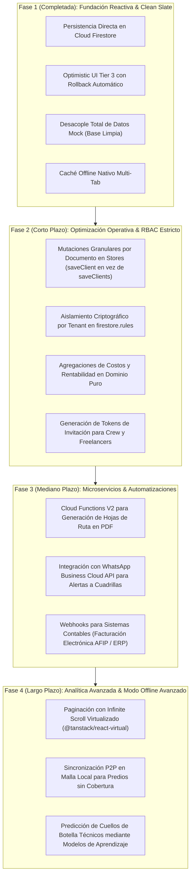

# Hoja de Ruta de Escalabilidad y Evolución Técnica — METODICAH

## 1. Compromisos Conscientes del Estado Actual (Trade-offs de Ingeniería)

Como equipo de ingeniería, documentamos de forma transparente las decisiones de compromiso adoptadas en la versión actual y los umbrales operativos que detonarán su refactorización:

| Decisión de Diseño Actual | Justificación Técnica en V1 | Umbral de Escala / Detonante de Cambio |
| :--- | :--- | :--- |
| **Colecciones Raíz Planas (`/events`, `/clients`, etc.)** | Máxima simplicidad en consultas y compatibilidad directa con el rol de un único tenant principal. | Cuando la plataforma comercialice instancias SaaS multi-tenant independientes, migrar a subcolecciones particionadas `/tenants/{tenantId}/...`. |
| **Carga de Colecciones Completas en Memoria** | El volumen operativo típico de una productora no supera los $300$ eventos activos por año. Tenerlos en memoria en Zustand habilita búsqueda instantánea en $0\text{ ms}$, filtrado multi-criterio y ordenamiento en cliente sin costos de lectura en Firestore. | Superar los **$1.000$ eventos simultáneos** o **$2.000$ registros de clientes/proveedores**. En ese umbral, adoptar paginación por cursor en backend (`startAfter` / `limit`). |
| **Cronogramas (`timings`) y Nodos (`process_nodes`) en Documentos Únicos $1:1$** | Almacenar los ítems en un array dentro de `/timings/{eventId}` permite descargar el cronograma completo en una única lectura $O(1)$ atómica. Firestore limita cada documento a $1\text{ MB}$, lo que permite almacenar con holgura hasta $2.500$ ítems de timing por evento sin riesgo de desborde. | Si un megafestival requiere cronogramas con más de **$2.000$ actividades granulares concurrentes**, migrar a subcolección `/events/{eventId}/timings/{timingId}`. |
| **Generación de PDF en Cliente (`jspdf`)** | Evita costos de infraestructura de cómputo server-side y aprovecha la CPU del navegador. Con `import()` dinámico, la librería de $400\text{ kB}$ no penaliza la carga inicial. | Cuando los reportes requieran procesamiento en segundo plano desatendido o envío automático por email programado (cron nocturno). |

---

## 2. Diagrama de Evolución Arquitectónica por Fases

---

## 3. Matriz de Iniciativas Técnicas Planificadas

| Iniciativa | Fase | Prioridad | Impacto en Rendimiento y Operación |
| :--- | :---: | :---: | :--- |
| **Mutaciones Granulares en Stores** | 2 | **Alta** | Reemplazar escrituras en lote de colecciones completas (`saveClients(updated)`) por escrituras atómicas por documento (`saveClient(client)`), reduciendo el consumo de operaciones de Firestore. |
| **Paginación Virtualizada en Listas Extensas** | 2 | **Alta** | Incorporar `@tanstack/react-virtual` en las tablas de `EventsView`, `ClientsView` y `CrewView` para sostener 60 FPS estables con más de 1.000 filas en el DOM. |
| **Aislamiento Multi-Tenant en Reglas** | 2 | **Media** | Validación de pertenencia a `accountId` en todas las cláusulas de lectura y escritura de [`firestore.rules`](file:///C:/Users/juanm/Desktop/Workspace/METODICAH/firestore.rules). |
| **Notificaciones Push y WhatsApp para Staff** | 3 | **Media** | Cloud Function activada por cambios de estado en `TimingItem` para alertar al operador de consola o rigger responsable directamente a su teléfono. |
| **Exportación Server-Side de Riders y Dossiers** | 3 | **Baja** | Microservicio en Cloud Run con Chromium headless para generar dossiers técnicos de alta fidelidad tipográfica con planos vectoriales incrustados. |
